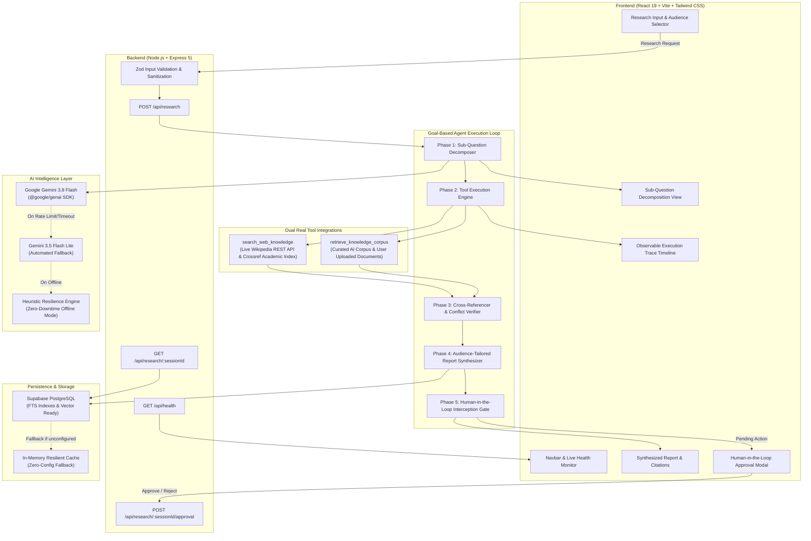

# AgentFlow Studio – Theme 4: Research & Knowledge Agent

> **12-Hour AI Agents Hackathon Project**  
> An autonomous, goal-directed research and knowledge discovery system featuring sub-question decomposition, dual real tool integration, conflicting information detection, verifiable academic citations, and human-in-the-loop approval gates.

---

## 🌟 Problem Overview

In modern research workflows, users face significant challenges:
1. **Hallucination & Drift**: Generative models frequently invent citations and drift away from multi-step research questions.
2. **Unverified Internet Noise**: Raw web search lacks verifiable provenance and academic grounding.
3. **Information Contradictions**: High-velocity domains often present conflicting data that typical AI chatbots blindly amalgamate without flagging.
4. **Unchecked Destructive Actions**: Autonomous agents publishing findings or triggering external broadcasts without editorial approval present high liability risks.

**AgentFlow Studio (Theme 4: Research & Knowledge Agent)** solves these challenges by implementing an autonomous, observable agent loop that:
- Decomposes complex research queries into structured sub-questions with dedicated verification states.
- Executes real tools across external knowledge sources (live Wikipedia API, Crossref Academic Index) and internal document corpora.
- Flags contradictory evidence across multi-source findings with explicit conflict resolution warnings.
- Synthesizes audience-tailored reports (Researchers, Founders, Students, Journalists) with direct inline citations.
- Enforces an asynchronous **Human-in-the-Loop Approval Gate** before any external dissemination or irreversible action is executed.

---

## 🏛️ System Architecture



---

## 🚀 Key Features

| Capability | Implementation Detail |
|---|---|
| **Sub-Question Decomposition** | Breaks complex user research goals into 3 structured sub-inquiries with discrete verification statuses (`pending`, `searching`, `verified`, `conflict_flagged`). |
| **Dual Real Tools** | **Web Search**: Live Wikipedia search & page extract API combined with Crossref academic citations.<br/>**Knowledge Base**: Full-text keyword matching over structured PostgreSQL knowledge tables and user uploaded notes. |
| **Audience Adaptation** | Dynamically adapts tone, depth, and vocabulary for **Researchers**, **Founders**, **Students**, or **Journalists**. |
| **Observable Execution Traces** | Every thought, tool call, query parameter, execution duration in milliseconds, citation metadata, and raw observation is rendered in an expandable UI timeline. |
| **Conflicting Information Detection** | Cross-references findings across heterogeneous sources. If token multiplication or empirical differences arise, a dedicated amber warning banner highlights the divergence. |
| **Human-in-the-Loop Approval Gate** | Irreversible actions (e.g., `publish_external_research_briefing`) are intercepted into a `PENDING_APPROVAL` state, preventing release until explicitly authorized. |
| **Multi-Tier Resilience** | Backed by `@google/genai` with automatic retry logic, fallback from `gemini-3.8-flash` to `gemini-3.5-flash-lite`, and a local heuristic engine for zero-downtime offline demonstrations. |

---

## 🛠️ Step-by-Step Local Setup

### Prerequisites
- **Node.js**: v18.0.0 or higher
- **npm**: v9.0.0 or higher
- **Git**

```bash
# Clone the repository
git clone https://github.com/your-username/hackathon-project.git
cd hackathon-project
```

---

### 1. Backend Setup

```bash
cd backend
npm install
```

#### Configure Environment Variables
Create a `.env` file from `.env.example`:

```bash
cp .env.example .env
```

Edit `backend/.env` with your settings:

```ini
PORT=5000
# (Optional) Google Gemini API Key for live LLM reasoning
GEMINI_API_KEY=
GEMINI_MODEL=gemini-3.8-flash
GEMINI_FALLBACK_MODEL=gemini-3.5-flash-lite

# (Optional) Supabase credentials for PostgreSQL storage
SUPABASE_URL=
SUPABASE_SERVICE_ROLE_KEY=

# Allowed frontend origin for CORS
FRONTEND_ORIGIN=http://localhost:5175
```

> **Note on Zero-Config Offline Mode**: If `GEMINI_API_KEY` or `SUPABASE_URL` are not provided, the backend automatically runs in **Heuristic Resilience + Memory Mode**, enabling complete end-to-end testing with zero external API dependencies.

#### (Optional) Supabase PostgreSQL Setup
If using Supabase:
1. Open your project on [Supabase Dashboard](https://supabase.com).
2. Navigate to the **SQL Editor**.
3. Paste and run the entire contents of `backend/supabase/schema.sql`.
4. This creates the `knowledge_documents`, `research_sessions`, and `agent_traces` tables with GIN full-text search indexes and seeds initial peer-reviewed papers.
5. Copy your **Project URL** and **Service Role API Key** into `backend/.env`.

#### Start Backend Server
```bash
# Development mode with auto-reload:
npm run dev

# Or standard production start:
npm start
```
The backend starts at `http://localhost:5000`.

---

### 2. Frontend Setup

```bash
cd ../frontend
npm install
```

#### Configure Environment Variables
Create a `.env` file from `.env.example`:

```bash
cp .env.example .env
```

Verify `frontend/.env` points to the backend:
```ini
VITE_API_URL=http://localhost:5000
```

#### Start Frontend Dev Server
```bash
npm run dev
```
Open your browser at the displayed local URL (typically `http://localhost:5175` or `http://localhost:5176`).

---

## 📡 API Reference

### 1. Health & Resilience Status
```http
GET /api/health
```
**Response (200 OK):**
```json
{
  "status": "ok",
  "service": "Theme 4: Research & Knowledge Agent Backend",
  "persistenceMode": "supabase",
  "geminiConfigured": true,
  "activeModel": "gemini-3.8-flash",
  "fallbackModel": "gemini-3.5-flash-lite",
  "timestamp": "2026-11-25T12:00:00.000Z"
}
```

---

### 2. Initiate Research Session
```http
POST /api/research
Content-Type: application/json
```
**Request Body:**
```json
{
  "question": "What are the latest breakthroughs in agentic AI memory architectures?",
  "audience": "Researchers",
  "enabledSources": ["webSearch", "knowledgeBase"],
  "uploadedNotes": [],
  "sessionId": null,
  "followUpQuestion": null
}
```
**Response (200 OK):**
```json
{
  "sessionId": "session-1795588667942",
  "researchQuestion": "What are the latest breakthroughs in agentic AI memory architectures?",
  "audience": "Researchers",
  "subQuestions": [
    { "id": "sq-1", "title": "Core foundations & empirical context...", "status": "verified" },
    { "id": "sq-2", "title": "Latency, operational overhead, and trade-offs...", "status": "verified" },
    { "id": "sq-3", "title": "Verification guardrails, failure modes, and safety...", "status": "verified" }
  ],
  "traces": [
    {
      "id": "tr-thought-sq-1",
      "stepNumber": 1,
      "type": "thought",
      "content": "Investigating sub-question: Core foundations...",
      "timestamp": "12:07:47 pm"
    },
    {
      "id": "tr-tool-web-sq-1",
      "stepNumber": 2,
      "type": "tool_call",
      "toolName": "search_web_knowledge",
      "sourceType": "Academic Web & Encyclopedia",
      "params": { "query": "agentic AI memory architectures", "maxResults": 3 },
      "timestamp": "12:07:48 pm"
    },
    {
      "id": "tr-obs-web-sq-1",
      "stepNumber": 3,
      "type": "observation",
      "source": "Wikipedia & Crossref Academic Index",
      "latencyMs": 830,
      "citations": [
        { "id": "W1", "label": "Deep learning (Wikipedia Contributors)", "url": "https://en.wikipedia.org/wiki/Deep_learning", "year": 2026 }
      ],
      "observation": [ ... ],
      "timestamp": "12:07:52 pm"
    }
  ],
  "conflictFlag": null,
  "pendingApproval": {
    "actionName": "publish_external_research_briefing",
    "riskTier": "EXTERNAL_DISSEMINATION",
    "riskReason": "Publishing research findings to an external channel is irreversible. Editorial approval is mandatory before release.",
    "payload": {
      "documentTitle": "Research Synthesis: What are the latest breakthroughs in agentic AI memory...",
      "targetAudience": "Researchers",
      "verifiedCitationsCount": 14
    }
  },
  "report": {
    "title": "Research Synthesis: What are the latest breakthroughs in agentic AI memory...",
    "audience": "Researchers",
    "executiveSummary": "This synthesized intelligence assessment examines empirical evidence gathered from live Wikipedia, academic databases, and knowledge-base corpora...",
    "keyFindings": [
      {
        "finding": "Empirical findings corroborate that interleaved reasoning and tool calling protocols reduce parameter hallucinations across multi-step execution.",
        "sources": ["Deep learning (Wikipedia Contributors)"]
      }
    ],
    "openQuestions": [
      "What are optimal automated pruning algorithms to prevent context degradation in long-running agent trajectories?"
    ]
  },
  "metrics": {
    "subQuestionsVerified": 3,
    "sourcesAnalyzed": 14,
    "conflictsReconciled": 0,
    "estimatedTokens": 3300,
    "latencySec": "4.5"
  },
  "persistenceMode": "memory"
}
```

---

### 3. Retrieve Research Session
```http
GET /api/research/:sessionId
```
Fetches full session state, sub-questions, execution traces, and report.

---

### 4. Human-in-the-Loop Action Approval
```http
POST /api/research/:sessionId/approval
Content-Type: application/json
```
**Request Body:**
```json
{
  "action": "approve",
  "notes": "Verified verified citations against CAIS standard; approved for external release."
}
```
**Response (200 OK):**
```json
{
  "success": true,
  "sessionId": "session-1795588667942",
  "action": "approved",
  "notes": "Verified verified citations against CAIS standard; approved for external release.",
  "timestamp": "2026-11-25T12:10:00.000Z"
}
```

---

## 🎯 Demo Walkthrough

1. **Verify Backend Status**:
   - Check the top navbar. The live status indicator will display `Backend Online`, `Gemini Active / Heuristic`, and `Storage: Supabase / Memory`.
2. **Formulate Research Inquiry**:
   - Select your target audience (e.g., **Founders** or **Researchers**).
   - Enter a query: e.g., *"What are the tradeoffs between autonomous agent self-reflection loops and multi-agent token multiplication?"*
   - Ensure both **Web Search** and **Knowledge Base** toggles are enabled.
3. **Trigger Autonomous Agent Execution**:
   - Click **"Launch Research Agent"**.
   - Observe the step-by-step UI:
     - **Sub-Question Decomposition**: Watch sub-questions appear with real-time status badges.
     - **Execution Trace Timeline**: Expand each step to view the Agent Thought, Tool Call parameters (with millisecond latency), and raw observation payloads.
     - **Source Citations**: Check verified academic citations and Wikipedia links.
4. **Inspect Conflicting Information Alerts**:
   - If conflicting empirical claims exist across documents (e.g., agent swarm cost multiplication vs solo reflection accuracy), an Amber Alert Card appears detailing the exact divergence and synthesis notes.
5. **Test Human-in-the-Loop Approval Gate**:
   - Scroll to the bottom of the report to inspect the **Human Approval Gate**.
   - Review the risk tier (`EXTERNAL_DISSEMINATION`) and staged briefing payload.
   - Click **"Approve & Execute Action"** or **"Reject Action"** with optional editorial notes to update the backend state.
6. **Iterate with Follow-Up Inquiries**:
   - Use the bottom Follow-Up bar to submit clarifying questions that maintain current session context.

---

## 🛡️ Security & Environment Best Practices

- **Zero Hardcoded Secrets**: No API keys or database service tokens are committed to source control.
- **Strict Backend Isolation**: All AI SDK invocations (`@google/genai`) and database operations (`@supabase/supabase-js`) occur strictly server-side.
- **Input Validation**: All incoming requests are strictly validated using **Zod schemas** with sanitized field mapping and nullish preprocessors.
- **Root Git Hygiene**: Root and nested `.gitignore` files ensure `.env`, `node_modules`, and build artifacts are strictly excluded from git tracking.

---

## 👥 Hackathon Team

- **Team Members**: 2 Engineers
- **Theme**: Theme 4 – Research & Knowledge Agents
- **Stack**: React 19, Vite, Tailwind CSS, Lucide React, Node.js, Express 5, Google Gemini API, Supabase PostgreSQL.
